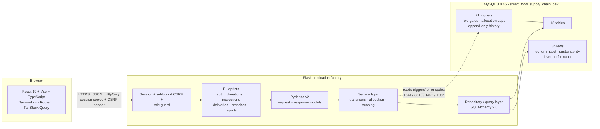
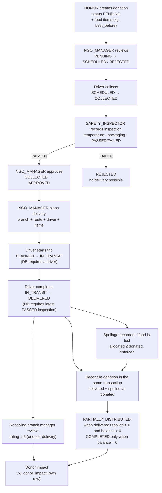

# APPLICATION ARCHITECTURE

**Product:** Smart Food Supply Chain & Surplus Redistribution System
**Phase:** Step 7 · Phase 0 (architecture only — no application code exists yet)
**Database of record:** `smart_food_supply_chain_dev` (18 tables · 3 views · 21 triggers · 12 CHECKs · 29 FKs)
**Frozen original:** `smart_food_supply_chain` — the application never connects to it.

---

## 1. System shape

A single-page React application talking to a Flask REST API over same-origin
cookies, backed by MySQL 8.0 and the business rules already enforced inside that
schema. Three layers, one deployable API, no microservices.



### Responsibilities

| Layer | Owns | Must not |
|---|---|---|
| React SPA | rendering, form validation, optimistic UI, charts, print/CSV requests | decide authorization, compute balances, invent figures |
| Flask middleware | session verification, CSRF, rate limits, and the per-request reload of `user_role` / `account_status` / `primary_branch_id` that authorization uses | trust a role or branch claim from the cookie, a header or the body |
| Blueprints | HTTP shape, status codes, pagination params | contain business rules |
| Services | transition rules, ownership checks, transactions, row locking | bypass triggers by disabling them |
| Repositories | SQLAlchemy queries, eager loading, aggregates | return ORM objects to the edge |
| Pydantic | request/response contracts, Decimal handling | leak `password_hash`, `reset_token_hash` |
| MySQL | structural truth: role gates, allocation caps, append-only history | be duplicated inconsistently |

**Rule:** every rule the database already enforces (role of donor/inspector/
driver, allocation ≤ donated, append-only history, temperature band, review
authorship) is treated as the *guarantee*. The service re-checks the same rule to
produce a useful 409/422 message, never to relax it. Where the database is silent
(status transition legality, branch scoping, lockout escalation) the service is
the only authority.

**Manager scope is single-sourced.** `branch.regional_manager_user_id` is the only
manager scope key: `scope_read`/`scope_write` build the managed-branch set from it
and nothing else. A manager with no managed branches therefore has an **empty**
branch scope — empty lists, zero overview counts, empty report aggregates and 404
for every detail — not a fallback read of their own
`app_user.primary_branch_id`. That column anchors a DONOR's donations (the
unrouted queue) and a SAFETY_INSPECTOR's jurisdiction; it is never OR-ed into a
manager predicate. There is no "all branches" mode, and the fix for an unassigned
manager is operator provisioning of `branch.regional_manager_user_id`, not an
application inference. The database privilege model matches this
column-scoped discipline: `sfc_app` has column-level `UPDATE` only, with
`app_user.primary_branch_id` and `branch.regional_manager_user_id` deliberately
outside it (`AUTH_SECURITY_DESIGN.md` §6.2).

---

## 2. Repository structure

```
dbms project/                      (existing root, kept)
├─ apps/
│  ├─ api/                         Flask service
│  │  ├─ src/sfc_api/
│  │  │  ├─ __init__.py            create_app() factory
│  │  │  ├─ config.py              env-driven config, no secrets in code
│  │  │  ├─ extensions.py          db, migrate-free metadata, limiter, csrf
│  │  │  ├─ models/                SQLAlchemy models, one module per cluster
│  │  │  ├─ schemas/               Pydantic v2 request/response models
│  │  │  ├─ services/              auth, donations, allocation, inspection,
│  │  │  │                         delivery, reports
│  │  │  ├─ repositories/          query objects, pagination, aggregates
│  │  │  ├─ api/                   blueprints: auth, users, donations,
│  │  │  │                         inspections, deliveries, spoilage,
│  │  │  │                         branches, routes, lookups, reports
│  │  │  ├─ security/              sessions, csrf, password policy, throttle
│  │  │  └─ cli.py                 `flask credential invite`, seed lookups
│  │  ├─ tests/                    pytest: unit · integration · contract
│  │  │                           conftest.py enforces the test-DB allowlist
│  │  ├─ pyproject.toml
│  │  └─ .env.example              names only, never values
│  └─ web/                         React SPA
│     ├─ src/
│     │  ├─ app/                   router, providers, query client
│     │  ├─ features/              auth, donations, inspections, deliveries,
│     │  │                         branches, routes, reports, activity
│     │  ├─ components/            ui primitives, tables, forms, charts
│     │  ├─ lib/                   api client, query keys, formatting
│     │  └─ styles/                tokens.css (brand), global.css
│     ├─ e2e/                      Playwright specs
│     ├─ vite.config.ts            dev proxy /api → :5000
│     └─ package.json
├─ database/                       existing: schema exports, migrations, runner,
│                                  audit scripts, prep_phase1 package (unchanged)
├─ docs/architecture/              this design set
├─ reports/                        existing Phase 2 evidence
├─ tests/fixtures/                 shared CSV/JSON fixtures for e2e + contract
└─ .gitignore                      extended for apps/*/node_modules, .venv, .env
```

**Deviation from the suggested layout:** `database/`, `reports/`, `docs/` stay at
the repository root because they already exist and are committed; moving them
would rewrite history for no benefit. `tests/` holds only cross-cutting fixtures;
pytest lives with the API and Vitest with the SPA.

---

## 3. Technology choices

| Area | Choice | Why this, not the alternative |
|---|---|---|
| API framework | **Flask 3.1** + application factory | already installed; factory + blueprints give test isolation without a framework migration |
| ORM | **SQLAlchemy 2.0** (typed `Mapped[]`) | models map to the **17 business tables and 3 views**; `schema_migrations` is deliberately *not* modelled, since the app has no privilege on it. No `create_all()`, no Alembic — the runner's ledger is the migration authority |
| Driver | **PyMySQL 1.1** + `cryptography` | pure-Python, works with `caching_sha2_password`; simpler than mysql-connector's pool semantics under SQLAlchemy |
| Validation | **Pydantic 2** | one schema source for request parsing *and* response serialisation; `Decimal` round-trips exactly |
| Sessions | signed cookie (itsdangerous) + DB-backed revocation check | no session table exists in the schema; a signed cookie plus the credential-version comparison revokes on password change without inventing a table. Idle 8 h inside an absolute 12 h, `iat` immutable |
| CSRF | **session-bound signed** double submit + `SameSite=Lax` + Origin check | a plain double-submit token is defeated by a sibling origin that can write a `Domain` cookie; the MAC over the session's random `sid` makes the injected value unverifiable. `sid` is minted per authentication session and rotated on every login/activation (`AUTH_SECURITY_DESIGN.md` §2.1.1) |
| Time | **`Asia/Kolkata`** end to end; `SET time_zone='+05:30'` per connection; offsets at the API boundary | `DATETIME` has no zone. One canonical zone avoids the classic "naive value labelled UTC" bug; no DST in IST |
| Frontend | **React 19 · Vite · TS** | required stack; Vite proxy keeps API same-origin, so no CORS in dev |
| Server state | **TanStack Query 5** | caching, invalidation after mutations, no duplicated fetches |
| Forms | **React Hook Form 7 + Zod 4** | Zod schemas mirror the Pydantic contracts field-for-field |
| Styling | **Tailwind CSS v4** (`@tailwindcss/vite`) + CSS custom properties for brand tokens | v4 is the current line; tokens keep the 60-30-10 palette enforceable |
| Charts | **Recharts 3** | only for the four operational charts listed in the UI system |
| Icons | **Lucide React** | single icon family, consistent stroke |
| Backend tests | **pytest 8** + `pytest-flask` | integration tests hit the disposable **`smart_food_supply_chain_api_test`** database through a test-only account, never `_dev` and never the original |
| Frontend tests | **Vitest 3 + React Testing Library 16** | component/behaviour tests without a browser |
| E2E | **Playwright 1.5x** | real cookie/CSRF flow through the browser |

Exact patch versions are pinned in `package-lock.json` / `pyproject` lock at
Phase A after a compatibility check; **no existing dependency is upgraded** —
none exist yet, and the described runtimes (Python 3.13.5, Node 24.20.0) are the
baseline.

---

## 4. Request lifecycle

```mermaid
sequenceDiagram
  participant B as Browser
  participant M as Middleware
  participant V as Blueprint
  participant S as Service
  participant D as MySQL

  B->>M: PATCH /api/donations/42/status (cookie + X-CSRF-Token)
  M->>M: verify cookie signature, session deadlines, rate limit
  M->>M: read uid/sid/csrf_id from that verified payload; recompute HMAC("csrf|"+sid+"|"+csrf_id+"|"+uid) and compare (sid is the per-session random id minted at login/activate, rotated on every new session)
  M->>M: load user_role, account_status, primary_branch_id, password_changed_at
  M->>M: reject when version > cookie epoch (password changed since mint)
  M->>V: identity {user_id, role, branch_scope} — all from that row, none from the cookie
  V->>V: Pydantic parse (extra="forbid") + validate transition request
  V->>S: change_status(actor, donation_id, target)
  S->>D: BEGIN · SELECT donation FOR UPDATE
  S->>S: ownership + transition table + latest-inspection gate
  S->>D: UPDATE donation · INSERT donation_status_history (NOW() server-side)
  D-->>S: trigger verdict (1644 / 3819 / 1452 / 1062) or OK
  S->>D: COMMIT
  S-->>V: DTO (Decimal, no internals)
  V-->>B: 200 {data, meta} | 409 {error}
```

Failure mapping is centralised and **coded, not echoed**: every SQLSTATE is
matched against the fixed table in `API_CONTRACT.md` §1.1 (`1644` → the specific
409/422/403 code, `3819` → 422 `validation_error`, `1452` → 422 `invalid_reference`,
`1062` → 409 `duplicate_resource`/`duplicate_review`), an unrecognised `1644`
becomes `409 business_rule_violation`, and anything else becomes 500
`internal_error` with a correlation id. A raw trigger message, table name or SQL
fragment is never returned.

Server-authoritative inputs never come from the request: `inspected_at`,
`reported_at`, `delivered_at`, `changed_at`, `review_date`, `last_login_at`,
`password_changed_at`, and every `*_user_id` that identifies the actor. The service
writes them in the same statement that stores the row, from the database clock
(`NOW()` under the connection's `+05:30` session timezone), and reads the stored
value back for the response.

---

## 5. Core business workflows



Four facts drive the diagram and are **not** re-implementable loosely:

1. **Inspection precedes delivery.** `trg_delivery_*` refuses to move a delivery to
   `IN_TRANSIT`/`DELIVERED` unless the latest inspection for that donation is
   `PASSED`, ordered `inspected_at DESC, inspection_id DESC` (verified in Phase 2).
   `inspected_at` is therefore server-set — a client-chosen timestamp could make a
   `PASSED` row permanently "latest". The order is total but not strictly
   increasing: `inspected_at` is `DATETIME` at second precision and `NOW()` is
   whole-second, so equal timestamps are possible and the auto-increment
   `inspection_id` picks the later insert. The queue helper and the trigger use the
   same two-key ordering, never the timestamp alone.
2. **Attribution is immutable once `DELIVERED`**, and a driver must hold the
   `DRIVER` role at the moment of assignment. A delivery's driver defaults to
   `route.designated_driver_user_id`, which is `NOT NULL`.
3. **History is append-only.** `donation_status_history` rejects UPDATE/DELETE with
   1644; a status change is always `UPDATE donation` + `INSERT history` in one
   transaction.
4. **Completion is arithmetic, not a count of deliveries.** A donation is
   `COMPLETED` only when `SUM(delivered) + SUM(spoiled)` equals the donated
   kilograms; one successful delivery is not enough unless it consumed the whole
   donation. The reconciliation runs in the transaction that records the delivery
   or spoilage event (`API_CONTRACT.md` §3.3).

---

## 6. Non-goals for v1

Explicitly out of scope, so they are not half-built: mobile apps, realtime push,
map routing/geocoding, payments, SMS/email delivery infrastructure, multi-tenant
organizations beyond the existing `organization` table, offline mode, a
schema-level notification table, any **delivery-status timeline** (the schema
stores only the current status — gap G12), and any **donation close-out** for
undeliverable surplus (there is no written-off state — gap G13; such a donation
stays `PARTIALLY_DISTRIBUTED` with a visible balance). All of these are listed
with their proposed migrations in `DATABASE_APPLICATION_MAPPING.md` §5.

## 7. Cross-document index

| Question | Document |
|---|---|
| Who may call which endpoint | `ROLE_PERMISSION_MATRIX.md` |
| What each table/trigger means for the app | `DATABASE_APPLICATION_MAPPING.md` |
| Exact request/response shapes | `API_CONTRACT.md` |
| Login, activation, sfc_app grants | `AUTH_SECURITY_DESIGN.md` |
| Colours, type, components | `UI_DESIGN_SYSTEM.md` |
| Build order and exit criteria | `IMPLEMENTATION_ROADMAP.md` |
