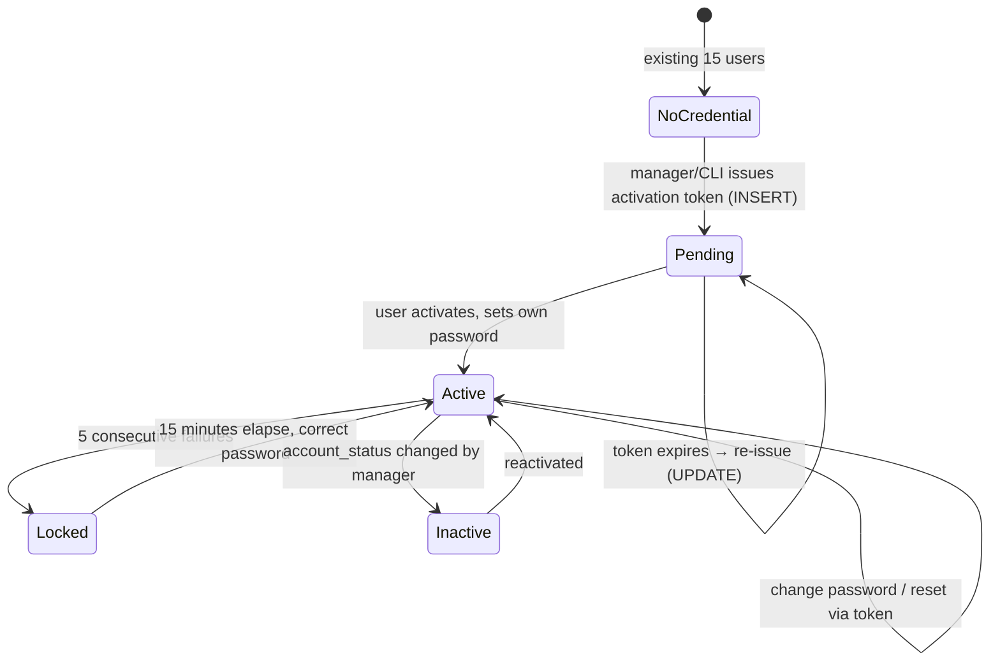
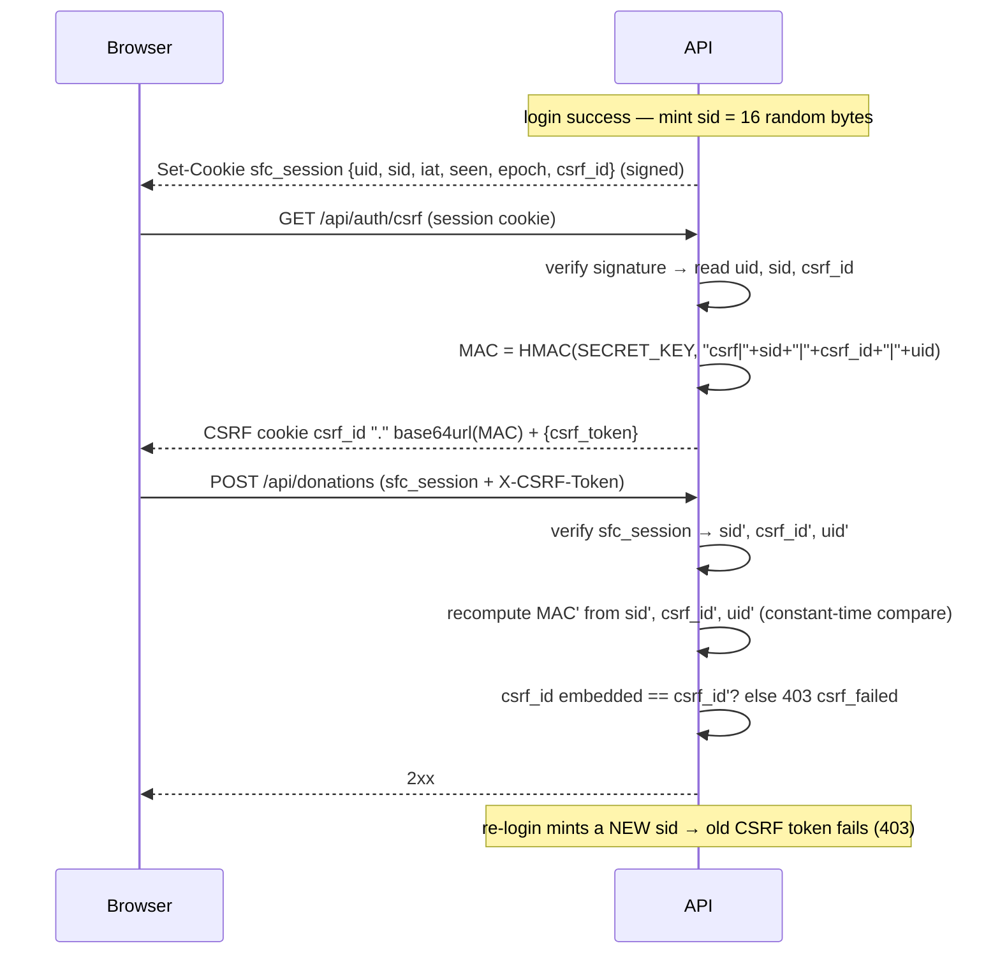

# AUTHENTICATION AND SECURITY DESIGN

Constraints inherited from Phase 1/2 (do not re-litigate): `user_credential` has
11 columns, `user_id` is its **primary key** (one row per user, so a second INSERT
is impossible by construction), the only approved hash policy is **Werkzeug scrypt
v1** (`scrypt:32768:8:1$…`), **no** existing user has a credential row, reset tokens
are stored as SHA-256 hex with a UNIQUE index, and both CHECKs must hold
(`chk_cred_lock_consistency`, `chk_cred_token_pairing`). Argon2 is **not** used or
claimed.

Verified from the DDL: `password_changed_at DATETIME NOT NULL DEFAULT CURRENT_TIMESTAMP`
— second precision, no fractional part, not nullable.

---

## 1. Credential lifecycle



### 1.1 Activation issuance

`POST /api/users/{id}/activation-token` (NGO_MANAGER, in scope) or the operator CLI
`flask credential invite --email …`. Because `user_credential.user_id` is the
primary key, issuance is **INSERT when no row exists, UPDATE when it does** — never
a second INSERT:

```text
-- no row yet (first invite for one of the 15 existing users)
INSERT INTO user_credential
  (user_id, password_hash, must_change_password, failed_attempts,
   reset_token_hash, reset_expires_at)
VALUES
  (:target, :scrypt_placeholder, 1, 0, :sha256_token, NOW() + INTERVAL 24 HOUR);

-- row already pending: replace the token, keep the row
-- (updated_at refreshes itself: ON UPDATE CURRENT_TIMESTAMP, not granted,
--  and deliberately not named in the SET list)
UPDATE user_credential
   SET reset_token_hash = :sha256_token,
       reset_expires_at = NOW() + INTERVAL 24 HOUR
 WHERE user_id = :target AND must_change_password = 1;
```

Re-issuing for an account that has already activated is **not** an activation; it
is a password reset (§1.4) and uses the same `UPDATE`.

Two design points that are easy to get wrong:

- The placeholder must be a **real scrypt string**, not `'invite-pending'`. The
  column is `NOT NULL`, and the audit's `cred_non_scrypt_hash` observation must
  stay 0. A random secret nobody knows is unusable for login and honest about it.
- The token pair is written together and cleared together, because
  `chk_cred_token_pairing` makes a half-written reset unstorable. Clearing both in
  one `UPDATE` satisfies it.

The raw token is returned **once** in the 201 response body (`API_CONTRACT.md` §2)
for the manager to hand to the account owner. It is never emailed in v1 (no mail
infrastructure), never written to an application log, never stored in plaintext —
only its SHA-256 hash reaches the database — and it never appears in a later user
response, an export, a metrics label or an analytics event.

### 1.2 scrypt v1 verification

```python
generate_password_hash(pw, method="scrypt:32768:8:1")   # N=32768, r=8, p=1
check_password_hash(stored, pw)                          # constant-time
```

Parameters are pinned explicitly — Werkzeug's default scrypt parameters have
changed across releases, and the audit accepts only `scrypt:32768:8:1`. On a
successful login, if the stored parameters differ from the policy the hash is
transparently rehashed in the same row. A rehash **does not touch**
`password_changed_at`: it is not a credential change, and bumping the version would
log the user out of every device for no security benefit. (The flip side is stated
in §2.2: a rehash is not a revocation event.)

Password policy: 12–128 characters, any characters and spaces, rejected if it
appears in a bundled 10k common-password list or equals the email local-part.
No forced symbol classes, no expiry rotation. Policy failures → 422
`password_policy` with the specific reason.

### 1.3 Login, throttling, lockout

| Step | Rule |
|---|---|
| Lookup | by email (case-insensitive) **and** load credential; missing user, missing credential and wrong password all produce the same 401 body and the same timing envelope (a dummy `check_password_hash` runs when there is nothing to compare, so response time does not leak existence) |
| Failure | `UPDATE user_credential SET failed_attempts = failed_attempts + 1`; at 5 → `locked_until = NOW() + 15 min` in the **same** statement (the CHECK requires `failed_attempts > 0` whenever `locked_until` is set) |
| Locked | **401** `account_locked` with `retry_after_seconds`, no password check at all — not 423 |
| Success | `failed_attempts = 0, locked_until = NULL` cleared together, `last_login_at = NOW()`, session issued |
| Per-IP throttle | 20 failures / 10 min / IP-hash → 429, independent of account lockout so one account cannot be used to deny service to others |
| Escalation | **not implemented in v1**: 15 → 30 → 60 min doubling needs a counter the schema does not have (gap **G2**). Fixed 15 minutes, stated plainly in the UI |

### 1.4 Password reset — operator/manager issued, no mail channel

v1 has **no email or SMS delivery**, so a public "email me a reset link" endpoint
would either enumerate accounts or create a token nobody can receive. Both are
unacceptable, so that endpoint does not exist. Reset is an **assisted** flow, using
the same token pair and the same CHECK constraints as activation:

| Step | Actor | Endpoint | Effect |
|---|---|---|---|
| 1 | NGO_MANAGER (in scope) or operator CLI `flask credential reset --email …` | `POST /api/users/{id}/password-reset-token` | generates a 32-byte token, **UPDATEs the existing row** with `SHA256(token)` + `reset_expires_at = NOW() + 24 h`, returns the raw token **once** |
| 2 | that manager / operator | out of band | hands the token to the user |
| 3 | the user | `POST /api/auth/password-reset/confirm {token, new_password}` | atomic redemption (§1.5): single use, expiry checked under lock, both token fields cleared, `must_change_password = 0`, credential version bumped so every session dies |

Scope restrictions on step 1: the target must be a user whose
`primary_branch_id` is a branch the manager manages; a manager cannot reset
another `NGO_MANAGER`, cannot reset a user outside their branches, and cannot
reset themselves (they use `POST /api/auth/password`). Out-of-scope targets answer
**404**, in scope but wrong role answers **403**. Every issuance is logged as
`password_reset_issued` with actor, target and `request_id` — never the token.

`confirm` is public because possession of the token *is* the proof; it reveals
nothing about whether an account exists beyond the token itself, and failures are
the single response `401 token_invalid_or_expired`.

### 1.5 Redemption is atomic and single-use under concurrency

Activation and reset share one code path. The whole check-and-consume is one
transaction, so exactly one concurrent request can win:

```text
BEGIN;
-- 1. locate + lock by the unique token hash. A locking read sees the latest
--    committed row even under REPEATABLE READ, so a loser cannot read stale state.
SELECT user_id, reset_expires_at
  FROM user_credential
 WHERE reset_token_hash = SHA2(:token, 256)
   FOR UPDATE;

-- 2. no row, or reset_expires_at <= NOW()  →  ROLLBACK; 401 token_invalid_or_expired
--    (the expiry check happens *inside* the lock, on the same clock as the write)

UPDATE user_credential
   SET password_hash      = :new_scrypt,
       reset_token_hash   = NULL,
       reset_expires_at   = NULL,
       must_change_password = 0,
       failed_attempts    = 0,
       locked_until       = NULL,
       password_changed_at = GREATEST(NOW(), password_changed_at + INTERVAL 1 SECOND)
 WHERE user_id = :uid;

-- 3. activation also records last_login_at and issues the session
COMMIT;   -- only now is the session cookie minted and returned
```

Properties, each following from the statement above:

- **One winner.** The first transaction holds the row lock through `COMMIT`. A
  concurrent second `SELECT … FOR UPDATE` blocks, then re-evaluates
  `reset_token_hash = SHA2(:token)` against the committed row, finds `NULL`, and
  returns **0 rows** → the same generic 401. It cannot observe a pre-update
  snapshot because a locking read reads the newest committed version.
- **Expiry is checked under the lock**, not before it, so a token cannot expire
  between the check and the write.
- **Hash and expiry are cleared together**, satisfying `chk_cred_token_pairing`.
- **The version bump happens in the same statement as the password write**, so no
  session can be minted in the gap between them.
- **No token is ever "half used"**: a failure rolls back and leaves the row
  untouched (a failed *policy* check happens before the transaction, so a weak
  password does not burn the token).
- The response is emitted only after `COMMIT`. A crash after commit before the
  response means the user retries with a token that is now gone — the correct
  failure mode (they can request a new one) rather than a double-use.

Test (roadmap C9): two threads redeem the same token; exactly one gets 204/200 and
one gets `401 token_invalid_or_expired`; a third sequential attempt also gets 401;
and the row ends with `reset_token_hash IS NULL AND reset_expires_at IS NULL`.

### 1.6 Which credential write is allowed

| Situation | Row state | Write | Why |
|---|---|---|---|
| First activation invite | no row | `INSERT` | `user_id` PK; nothing to update |
| Re-issue activation token | row exists, `must_change_password = 1` | `UPDATE` token pair | never a second INSERT |
| Password-reset issuance | row exists (account active) | `UPDATE` token pair | same |
| Redeem activation/reset | row exists | `UPDATE` password + clear pair + bump version | atomic, §1.5 |
| Login success/failure | row exists | `UPDATE` counters | |
| Change own password | row exists | `UPDATE` hash + version bump | revokes other sessions |

A second `INSERT` for an existing user is impossible (primary key) and the service
never attempts it: issuance always `SELECT … FOR UPDATE` the row first and branches
on presence.

---

## 2. Session design

### 2.1 Cookie

| Attribute | Value |
|---|---|
| Name | `sfc_session` (`__Host-sfc_session` when `Secure`) |
| Content | signed (itsdangerous) payload `{uid, sid, iat, seen, epoch, csrf_id}` — **no role, no branch**, no PII, no token. `sid` is the per-session identifier: 16 bytes from `secrets.token_bytes(16)` (base64url), minted at login/activation and rotated on every new authentication session (§2.1.1). `csrf_id` is an independent random 16-byte CSRF binding value |
| Authoritative claims | **none.** `user_role`, `account_status` and `primary_branch_id` are re-read from `app_user` on every authenticated request (§2.2). The cookie identifies a session; it never asserts an authorization fact |
| `HttpOnly` | yes |
| `Secure` | yes outside `FLASK_ENV=development` |
| `SameSite` | `Lax` |
| `Path` / `Domain` | `/` · host-only (`__Host-` prefix forbids `Domain`) |
| Lifetime | idle **8 h**, absolute **12 h** (§2.4) |
| Secret | `SECRET_KEY` from environment, 32+ random bytes, rotated with a documented re-login |

`epoch` is the serialised credential version: the **exact stored string** of
`password_changed_at`, `YYYY-MM-DDTHH:MM:SS`, parsed back to a naive datetime for
comparison. It is never a wall-clock "now" and never a float. (`epoch` is the field
earlier drafts called `pwd_epoch`; it is one value under one name, and it is **not**
part of the CSRF MAC — that binds `uid`, `sid` and `csrf_id` only.)

### 2.1.1 `sid` — the session identifier the CSRF MAC is keyed on

`sid` is not decorative and not a second credential; it exists so that a CSRF token
can be bound to one specific session. Its contract is small and exact:

| Property | Rule |
|---|---|
| Value | `base64url(secrets.token_bytes(16))` — 128 bits from the OS CSPRNG, generated server-side. It is never derived from the user, the password, a counter or the clock |
| Where it lives | **only** inside the signed `sfc_session` payload (`HttpOnly`, §2.1). Never a URL, header, body, log line, metric label or response field |
| Minted | at the moment a session is created: successful `POST /api/auth/login` and successful `POST /api/auth/activate` |
| Rotated | on **every new authentication session** — each login/activation mints a fresh `sid` *and* `csrf_id` and rewrites the CSRF cookie. A re-login never inherits the previous session's identifier or CSRF token |
| Not rotated by | the idle `seen` refresh of §2.4, which re-signs the same payload in place. Rotating there would invalidate the SPA's CSRF token for no security gain |
| Destroyed | on logout (cookie cleared, §2.3 step 5) and implicitly on any password change/reset, which revokes the whole session (§2.2) |
| Consumer | exactly one: the CSRF validation in §2.3 step 2, which reads it from the **same signed payload it just verified** — never from the CSRF cookie, a header, a database lookup or a second cookie |

Because `sid` is inside the HttpOnly session cookie, a sibling origin that can write
its own `Domain`-scoped CSRF cookie still cannot compute a matching MAC (§2.3).

### 2.2 Per-request identity, role and branch freshness

No session table exists (gap **G3**), so the cookie cannot be trusted to carry
anything that may change. Every authenticated request performs the same fixed
procedure, in this order, before any handler logic runs:

1. **Verify the signature** of `sfc_session`. Invalid or expired → 401
   `session_expired`, cookie cleared. Nothing in the payload is trusted as an
   authorization fact; the verified payload's `sid` is read for exactly one
   purpose, the CSRF MAC of §2.3.
2. **Load the current row** by `uid`:
   `SELECT u.user_role, u.account_status, u.primary_branch_id, c.password_changed_at
      FROM app_user u LEFT JOIN user_credential c ON c.user_id = u.user_id
     WHERE u.user_id = :uid`.
3. **Reject** when the row is missing, `account_status != 'ACTIVE'`, the credential
   row is gone, or `password_changed_at > epoch` (password changed or reset since
   this session was minted).
4. **Authorize with the database values** — `user_role` from step 2 drives the
   role gate, and `primary_branch_id` feeds the scope predicate. The cookie has no
   role to fall back on, so a stale claim is not merely ignored: it cannot exist.

Consequences, stated deliberately:

| Event | Effect |
|---|---|
| Role changed in the database | takes effect on the **next request**; the current session is not invalidated |
| Branch reassignment (`primary_branch_id`) | scope changes on the **next request** |
| Account suspended/inactivated | next request is rejected, 401 |
| Password changed or reset | every existing session is rejected via the version bump |
| New login / activation | a fresh `sid` and `csrf_id` are minted (§2.1.1), so the previous session's CSRF token no longer verifies |
| Transparent scrypt rehash | **no** revocation — the version is deliberately untouched (§1.2) |
| User deleted | impossible: no `DELETE` grant on `app_user`; deactivation only |

Cost: one indexed primary-key read per authenticated request (plus one credential
read), which is cheaper than the authorization mistake it prevents.

**The epoch comparison is monotonic by construction.** `password_changed_at` is
`DATETIME` with second precision, so `NOW()` alone would not guarantee a change
between two writes in the same second. Every credential write therefore uses
`GREATEST(NOW(), password_changed_at + INTERVAL 1 SECOND)`: the value strictly
increases on every change, so a session minted before the change always compares
`stored > epoch` and dies, and a session minted after reads the new value and
survives. The trade-off is honest: under several changes within one second the
stored timestamp runs up to N−1 seconds ahead of the wall clock. It is a version
counter expressed as a datetime; it is never displayed to end users and audit views
label it "credential version (may lead clock by <1 s per rapid change)".
Gap **G14** proposes the cleaner long-term form (`session_epoch BIGINT UNSIGNED`
incremented atomically, plus `DATETIME(6)`), which removes the drift entirely; v1
does not need it to be correct.

Remaining limitation: a single device cannot be revoked while others stay live, and
there is no per-device inventory — gap **G3** (`auth_event` / session table) is the
fix.

### 2.3 CSRF — session-bound signed double submit

The `csrf_id` in the session payload is **used**, not decorative, and the MAC is
keyed on the payload's `sid` (§2.1.1). The token is bound to the triple
**(`uid`, `sid`, `csrf_id`)**.

1. `GET /api/auth/csrf` sets and returns a CSRF cookie. After login the value is
   `csrf_id "." base64url(HMAC-SHA256(SECRET_KEY, "csrf|" + sid + "|" + csrf_id +
   "|" + uid))`, where all three inputs are read from the **verified** `sfc_session`
   payload of that request. Pre-authentication there is no session and therefore no
   `sid`, so the MAC covers a random nonce the server stores nowhere:
   `nonce "." base64url(HMAC(SECRET_KEY, "pre|" + nonce))`.
   The cookie is **not** HttpOnly (the SPA must read it), `SameSite=Lax`, `Secure`
   in production, and `__Host-` prefixed in production so no sibling origin can set
   a `Domain`-scoped copy.
2. Every unsafe method (`POST/PATCH/PUT/DELETE`) must send `X-CSRF-Token` with
   exactly the cookie value (constant-time compare), **and** the server must
   recompute the MAC from **the same `sid`, `csrf_id` and `uid` it just read out of
   the verified session cookie** — not from the CSRF cookie, not from the request,
   not from a stored session record (there is none). The embedded `csrf_id` must
   equal the session's `csrf_id`. Validation order is fixed:
   verify `sfc_session` signature → read `uid`/`sid`/`csrf_id` from that payload →
   recompute `HMAC("csrf|" + sid + "|" + csrf_id + "|" + uid)` → constant-time
   compare. A request without a valid session cookie cannot pass an authenticated
   CSRF check at all: it fails at step 1 of §2.2 with 401 `session_expired`, before
   any 403 could be produced. Mismatch or absence → 403 `csrf_failed`.
3. `Origin` (or `Referer` fallback) must equal the configured app origin on every
   unsafe method — including login and activation. This is retained exactly as
   before and is independent of the token check.
4. Login and activation require a pre-auth token, so a cross-site login-CSRF cannot
   bind a victim to an attacker's session; the response rotates to an
   authenticated token bound to the newly minted `sid`.
5. Rotation: a new session (`login`, `activate`) mints a fresh `sid` **and**
   `csrf_id` and rewrites the CSRF cookie. Logout clears both. A password change or
   reset invalidates the session entirely, so the CSRF material dies with it.



The diagrams in `APPLICATION_ARCHITECTURE.md` §1 and §4 show the same order: the
session signature is verified first, and the CSRF MAC is recomputed from that
verified payload before any handler runs.

**Why an attacker cannot inject a matching token.** Double-submit alone is
defeated by an untrusted sibling origin (`evil.example.com`) that writes a
`Domain=example.com` cookie: the attacker then knows the cookie value and can put
the same value in the header. Here the value they can write carries no valid MAC —
producing one requires `SECRET_KEY` and the victim's `sid`, and `sid` lives inside
the **HttpOnly** session cookie they cannot read. So a forged cookie fails check 2
against the real session. In production the `__Host-` prefix additionally makes a
`Domain`-scoped overwrite impossible at the browser level, and `SameSite=Lax` keeps
the session cookie off cross-site subrequests. An attacker who can run script on the
app's own origin is out of scope for CSRF (that is XSS, handled by CSP and output
encoding).

The SPA fetches the CSRF token after login (and on a 403 `csrf_failed` retry) and
attaches it in the API client's request interceptor.

### 2.4 Session lifetime: idle 8 h inside an absolute 12 h

| Clock | Value | Where |
|---|---|---|
| `iat` | session mint time, **never rewritten** | signed payload |
| Absolute deadline | `iat + 12 h` | enforced server-side on every request |
| `seen` | last accepted activity | signed payload, refreshed |
| Idle deadline | `seen + 8 h` | enforced server-side |
| Cookie `Expires`/`Max-Age` | `min(seen + 8 h, iat + 12 h)` | browser |

Procedure: reject with 401 `session_expired` when `now > iat + 12 h`; reject when
`now > seen + 8 h`; otherwise, if `now - seen > 5 min`, re-sign the cookie with
`seen = now` (same `iat`, same `sid` and `csrf_id` — a refresh is not a new
authentication session) and `exp = min(seen + 8 h, iat + 12 h)`. Throttling the
re-sign to once per 5 minutes avoids a `Set-Cookie` on every request while keeping
the idle window aligned to real activity.

**Stateless consequence, stated plainly:** `seen` is only as fresh as the last
cookie the client presented, and each copy of the cookie refreshes independently.
Two copies of the same cookie therefore do not invalidate each other, and a stolen
copy can keep itself alive up to the absolute 12 h limit. The absolute limit is
hard — it cannot be extended by activity — but the idle limit is advisory against
casual theft, not a per-user kill switch. A real fix needs server-side session
state (gap **G3**). The credential-version check in §2.2 still revokes everything on
a password change.

### 2.5 Session-related responses

`GET /api/auth/me` returns the profile, never the cookie, never a token. Logout
clears the cookie server-side and client-side (`204`). No endpoint returns
`password_hash`, `reset_token_hash`, `reset_expires_at`, `failed_attempts` or
`locked_until` to anyone, including the account owner.

---

## 3. Authorization model

Authentication answers *who*; authorization is two independent checks, both in the
service layer, both fed exclusively by the values loaded in §2.2 step 2:

1. **Role gate** — the endpoint's declared roles, compared against the database's
   current `user_role`. A role carried in the cookie, a header, a query string or a
   request body is never consulted (there is no such claim).
2. **Scope predicate** — a mandatory repository filter (`scope_read` /
   `scope_write`) built from the database's current `primary_branch_id` and the
   manager/branch, driver/route or donor/ownership relations, applied before any
   row is read or written. Read and write predicates are defined separately in
   `ROLE_PERMISSION_MATRIX.md` §1. For an NGO_MANAGER the branch dimension is
   **only** `branch.regional_manager_user_id = me`; the manager's own
   `app_user.primary_branch_id` is not a scope anchor, so a manager with no managed
   branch gets empty results and 404 details rather than a fallback read.

Because both inputs are re-read per request, a role downgrade or a branch transfer
is fully effective on the next request even though the session continues.

Out-of-scope records return **404**, so the API never confirms that another
branch's delivery exists. 403 is reserved for in-scope actions the role may not
perform. Both are enforced server-side; the SPA's route guards are UX only.

Data written by the service is always attributed server-side
(`donor_user_id = me`, `changed_by_user_id = me`, `inspector_user_id = me`,
`reported_by_user_id = me`, `reviewer_user_id = me`). Requests cannot supply those
ids, and event timestamps are server-set (`API_CONTRACT.md` §8.7).

---

## 4. Input validation and injection defence

- Every request body/query string is parsed by a Pydantic v2 model with
  `extra="forbid"`; unknown fields are a 422, not silently ignored. This is what
  makes a stray `inspected_at` or `reported_at` a rejection instead of an
  override.
- All SQL goes through SQLAlchemy bound parameters. The only dynamic SQL is the
  whitelisted `sort` field and column names, mapped through a dictionary — never
  string-interpolated from user input.
- `q` search terms are escaped for `LIKE` (`%`, `_`, `\`) and length-capped at 100.
- Quantities are `Decimal` end to end (`decimal.Decimal` in Pydantic, `Numeric(8,2)`
  in SQLAlchemy). No `float` on a quantity path.
- Response bodies are Pydantic models, so an ORM attribute can never leak by
  accident.
- Time handling follows `API_CONTRACT.md` §9: one canonical zone
  (`Asia/Kolkata`), `SET time_zone = '+05:30'` per connection, offsets at the
  boundary, no `utcnow()`.

---

## 5. Logging and audit-friendliness

Structured JSON lines with `request_id`, `route`, `status`, `duration_ms`,
`user_id` (when known), `ip_hash` and `event` for security events:
`login_success`, `login_failure`, `login_locked`, `activation`,
`activation_token_issued`, `password_change`, `password_reset_issued`,
`token_redeemed`, `token_redeem_failed`, `csrf_failure`, `permission_denied`,
`session_expired`.

`password_reset_issued` is the single name for a reset-token issuance; there is no
`password_reset_request` event because that flow does not exist. Issuance and
redemption log actor, target and `request_id` only — never the token, its hash, or
the password.

Never logged: passwords, raw tokens, token hashes, session cookie values, full
email addresses in error paths (hashed or truncated), SQL text or stack traces in
production responses. `request_id` is echoed in error envelopes so a user report
can be matched to a server line.

---

## 6. Database least privilege (`sfc_app`) — derived from the API

### 6.1 The problem

RUNNER_DESIGN §5b starts from `GRANT SELECT, INSERT ON db.*` and then adds
`UPDATE` per table, because MySQL privileges are additive and a table-level
`REVOKE` cannot subtract from a database-wide `GRANT` (§5c). That leaves one
residual hole, recorded in §5d: the database-wide `INSERT` also allows the
application to write rows into `schema_migrations`. The migration ledger is
infrastructure; the app must not be able to forge or delete migration history.

### 6.2 Resolution — a grant for every documented operation, and nothing else

Remove the database-wide grant entirely. Every privilege below exists because a
documented endpoint or service path needs it; every privilege not listed does not
exist. **45 statements** = 17 table `SELECT` + 3 view `SELECT` + 13 `INSERT` +
3 `DELETE` + 9 **column-scoped** `UPDATE`. The nine UPDATE statements carry
explicit column lists, so the expected privilege set is **36 table-level rows +
35 column-level rows = 71 rows** across `TABLE_PRIVILEGES` and
`COLUMN_PRIVILEGES` (§6.3).

### 6.2.1 Column-level UPDATE — why, and which columns

MySQL's table-level `UPDATE` applies to **every** column. A table-level grant on
`app_user` would therefore let the application promote an account to
`NGO_MANAGER` or move it to another branch, even though no endpoint accepts those
fields — the grant would be broader than the permission matrix
(`ROLE_PERMISSION_MATRIX.md` §2 and §7), which restricts several operations to
particular columns. The grant must state the same restriction the API does.

**Rule used below:** a column appears in an UPDATE grant only if a documented API
request field, or a documented service write, updates it. Column names are quoted
from `database/schema_post_migrations.sql` — none is invented. Excluded by
construction:

- **Identity / ownership / foreign-key columns of an existing row**
  (`donation.donor_user_id`, `dependent`'s composite PK, `delivery.donation_id`,
  `delivery.route_id`, `delivery.recipient_branch_id`, `delivery_item.delivery_id`,
  `delivery_item.food_item_id`, `donation_item.food_item_id`,
  `app_user.user_role`, `app_user.primary_branch_id`,
  `branch.regional_manager_user_id`, `branch.organization_id`,
  `route.managing_branch_id`). Re-attributing or re-homing a row is an operator or
  migration decision, never an application write.
- **Creation-only columns** (`donation.pickup_datetime`, `donation.urgency_level`,
  `donation_item.category_id`, `donation_item.prepared_at`,
  `branch.established_date`, `user_credential.created_at`).
  They are written by the INSERT path (table-level `INSERT`, §6.2.2) and are not
  accepted by any PATCH.
- **Server-maintained columns**: `user_credential.updated_at` is
  `ON UPDATE CURRENT_TIMESTAMP` and needs no grant — MySQL refreshes it inside the
  UPDATE statement even though it is not named in the statement and carries no
  column privilege. `delivery.delivered_at` is **granted**, because the service
  writes it explicitly with `NOW()` and it has no automatic behaviour.

The sensitive columns below are deliberately granted because a real workflow needs
them. Each is justified here, with the service checks that bound it:

| Granted column | Why the API needs it | Service-level scope check | Residual risk |
|---|---|---|---|
| `donation_item.donation_id` | re-parent an item to another donation (`PATCH /api/donation-items/{id}`) | caller is the DONOR who owns **both** donations, item is `PENDING`, and it has no delivery or spoilage rows; `trg_donation_item_update_guard` re-checks allocations in the database | moves an item only between the owner's own `PENDING` donations; cannot touch another donor's item |
| `delivery.driver_user_id` | assign or change the driver before departure (`PATCH /api/deliveries/{id}`, `POST /api/deliveries`) | caller is the manager of the delivery's branch/route; target must be an `ACTIVE` `DRIVER` on that route or the route's designated driver; `trg_delivery_driver_update` freezes attribution once `DELIVERED` | a re-assignment before departure is auditable only through gaps **G5**/**G12** (no driver-correction or status-event table) |
| `donation.pickup_route_id` | route an unrouted donation (`PATCH /api/donations/{id}/route`) and donor pickup edits | caller manages the target route's `managing_branch_id`; donation is `PENDING`/`SCHEDULED`; donor is anchored to a managed branch (§3.2 of the API contract) | assigning a route also defines which branch sees the donation — deliberate and the documented unrouted workflow |
| `donation.donation_status` | every service-owned transition, including the derived `PARTIALLY_DISTRIBUTED`/`COMPLETED` states | transition table + latest-inspection gate + actor scope; derived states are not requestable (`422`) | status is the workflow's core field; history rows record each change, append-only |
| `app_user.account_status` | `PATCH /api/users/{id}` deactivation/reactivation | target's `primary_branch_id` ∈ managed branches, target is not an `NGO_MANAGER`, target is not self; only `ACTIVE`/`INACTIVE` | the app cannot change a role or a branch assignment |
| `user_credential.*` (8 columns) | activation/reset issuance, redemption, login counters, password change | token hash + expiry checked under `FOR UPDATE`; scrypt policy; version bump revokes sessions | credential material is the account's security boundary; write set is fixed and excludes `user_id`/`created_at` |
| `route.designated_driver_user_id` | `PATCH /api/routes/{id}` | driver is `ACTIVE` with `DRIVER` role (`NOT NULL` in the schema); manager manages the route's branch | changing the designated driver changes who may confirm collection |
| `delivery.delivery_status` + `delivered_at` | status transitions | `PLANNED→IN_TRANSIT` needs a driver, `→DELIVERED` needs the latest `PASSED` inspection; manager/driver scope | both are the delivery's workflow fields; there is no status-history table (**G12**) |

Everything else the application writes at creation time comes from the table-level
`INSERT` grants (§6.2.2), where the row does not yet exist and attribution is set
server-side from the session. The immutability guarantees above apply to
**existing** rows, which is exactly where a table-level UPDATE would have been
dangerous.

| Table | SELECT | INSERT (endpoint / service) | UPDATE (endpoint / service) | DELETE |
|---|---|---|---|---|
| `organization` | yes — `GET /api/organizations`, branch form | **no** — read-only reference data; provisioning is operator CLI | **no** | no |
| `branch` | yes — list/detail, scope joins | yes — `POST /api/branches` | **column-scoped** — `branch_name`, `address`, `pincode`, `contact_no` (`PATCH /api/branches/{id}`). `regional_manager_user_id`, `organization_id`, `established_date` **not** granted | no |
| `app_user` | yes — login, `/auth/me`, `/users`, every scope join | **no** — accounts are created by the operator CLI, never by the API | **column-scoped** — `account_status` only (`PATCH /api/users/{id}`). `user_role`, `primary_branch_id`, `supervisor_user_id`, `email`, `full_name`, `phone` **not** granted | no |
| `user_credential` | yes — login, §2.2 freshness, redemption lookup | yes — first activation invite (§1.1) | **column-scoped** — `password_hash`, `must_change_password`, `failed_attempts`, `locked_until`, `last_login_at`, `password_changed_at`, `reset_token_hash`, `reset_expires_at`. `user_id`, `created_at`, `updated_at` **not** granted (`updated_at` is `ON UPDATE CURRENT_TIMESTAMP`) | no |
| `route` | yes — list/detail, scope joins | yes — `POST /api/routes` | **column-scoped** — `designated_driver_user_id`, `coverage_area_id`, `route_type`, `route_status` (`PATCH /api/routes/{id}`). `managing_branch_id` **not** granted | no |
| `coverage_area` | yes — `GET /api/coverage-areas` | **no** — lookup | **no** | no |
| `route_assignment` | yes — roster | yes — `POST /api/route-assignments` | **no** — change hours by replacing the row | yes — `DELETE /api/route-assignments/{user_id}/{route_id}` |
| `donation` | yes — every donation read | yes — `POST /api/donations` | **column-scoped** — `pickup_route_id`, `pickup_address`, `pickup_pincode`, `pickup_contact`, `donation_status` (`PATCH /api/donations/{id}`, `/route`, `/status`). `donor_user_id`, `pickup_datetime`, `urgency_level` **not** granted | no |
| `food_category` | yes — `GET /api/food-categories`, item form | **no** — lookup | **no** | no |
| `donation_item` | yes — items, freshness, allocation | yes — create donation, `POST /items` | **column-scoped** — `item_name`, `quantity_kg`, `best_before`, `donation_id` (`PATCH /api/donation-items/{id}`). `food_item_id`, `category_id`, `prepared_at` **not** granted | no (gap G9) |
| `donation_status_history` | yes — history, activity | yes — every accepted transition | **no** — append-only | no |
| `inspection_log` | yes — inspections, queue, notification of verdict | yes — `POST /api/inspections` | **no** — inspections are historical facts | no |
| `dependent` | yes — driver's list | yes — `POST /api/dependents` | **column-scoped** — `full_name`, `relationship`, `date_of_birth`, `phone` (`PATCH /api/dependents/{u}/{n}`). PK columns `driver_user_id`, `dependent_no` **not** granted | yes — `DELETE /api/dependents/{u}/{n}` |
| `delivery` | yes — delivery reads, reports | yes — `POST /api/deliveries` | **column-scoped** — `driver_user_id`, `scheduled_for`, `delivery_status`, `delivered_at` (`PATCH /api/deliveries/{id}`, `/status`). `donation_id`, `route_id`, `recipient_branch_id` **not** granted | no |
| `delivery_item` | yes — allocation, reports | yes — create delivery, `POST /items` | **column-scoped** — `quantity_delivered_kg` (`PATCH /api/delivery-items/{id}`). `delivery_id`, `food_item_id` **not** granted | yes — `DELETE /api/delivery-items/{id}` |
| `spoilage_record` | yes — spoilage list, reconciliation | yes — `POST /api/spoilage` | **no** — no PATCH endpoint exists | no |
| `delivery_review` | yes — review display | yes — `POST /api/deliveries/{id}/review` | **no** — one review, no edit endpoint | no |
| `schema_migrations` | **no** | **no** | **no** | **no** |

| View | Security | Granted | Consumer |
|---|---|---|---|
| `vw_donor_impact` | INVOKER (definer `sfc_migrator`) | yes | donor's own impact row and donor report — needs the base-table `SELECT`s above, which it has |
| `vw_donor_sustainability` | DEFINER=root | yes | the labelled legacy metric only |
| `vw_driver_performance` | DEFINER=root | yes | driver's **own** row only |

Only these three views are granted because only these three are read. Manager
reporting never touches `vw_donor_impact` or `vw_driver_performance` for a
branch-scoped figure — see `DATABASE_APPLICATION_MAPPING.md` §2.1 — so the grants do
not imply a permission to misuse them.

```sql
CREATE USER 'sfc_app'@'localhost' IDENTIFIED BY '<from secret store>';

-- 1. Read the business tables — one statement per table.
--    schema_migrations is NOT here and appears in no grant below it either.
GRANT SELECT ON smart_food_supply_chain_dev.organization            TO 'sfc_app'@'localhost';
GRANT SELECT ON smart_food_supply_chain_dev.branch                  TO 'sfc_app'@'localhost';
GRANT SELECT ON smart_food_supply_chain_dev.app_user                TO 'sfc_app'@'localhost';
GRANT SELECT ON smart_food_supply_chain_dev.user_credential         TO 'sfc_app'@'localhost';
GRANT SELECT ON smart_food_supply_chain_dev.route                   TO 'sfc_app'@'localhost';
GRANT SELECT ON smart_food_supply_chain_dev.coverage_area           TO 'sfc_app'@'localhost';
GRANT SELECT ON smart_food_supply_chain_dev.route_assignment        TO 'sfc_app'@'localhost';
GRANT SELECT ON smart_food_supply_chain_dev.donation                TO 'sfc_app'@'localhost';
GRANT SELECT ON smart_food_supply_chain_dev.food_category           TO 'sfc_app'@'localhost';
GRANT SELECT ON smart_food_supply_chain_dev.donation_item           TO 'sfc_app'@'localhost';
GRANT SELECT ON smart_food_supply_chain_dev.donation_status_history TO 'sfc_app'@'localhost';
GRANT SELECT ON smart_food_supply_chain_dev.inspection_log          TO 'sfc_app'@'localhost';
GRANT SELECT ON smart_food_supply_chain_dev.dependent               TO 'sfc_app'@'localhost';
GRANT SELECT ON smart_food_supply_chain_dev.delivery                TO 'sfc_app'@'localhost';
GRANT SELECT ON smart_food_supply_chain_dev.delivery_item           TO 'sfc_app'@'localhost';
GRANT SELECT ON smart_food_supply_chain_dev.spoilage_record         TO 'sfc_app'@'localhost';
GRANT SELECT ON smart_food_supply_chain_dev.delivery_review         TO 'sfc_app'@'localhost';

-- 2. Read the three views the application actually queries.
GRANT SELECT ON smart_food_supply_chain_dev.vw_donor_impact         TO 'sfc_app'@'localhost';
GRANT SELECT ON smart_food_supply_chain_dev.vw_donor_sustainability TO 'sfc_app'@'localhost';
GRANT SELECT ON smart_food_supply_chain_dev.vw_driver_performance   TO 'sfc_app'@'localhost';

-- 3. Append, table by table: one per documented INSERT path (§6.2 matrix).
GRANT INSERT ON smart_food_supply_chain_dev.branch                  TO 'sfc_app'@'localhost';
GRANT INSERT ON smart_food_supply_chain_dev.user_credential         TO 'sfc_app'@'localhost';
GRANT INSERT ON smart_food_supply_chain_dev.route                   TO 'sfc_app'@'localhost';
GRANT INSERT ON smart_food_supply_chain_dev.route_assignment        TO 'sfc_app'@'localhost';
GRANT INSERT ON smart_food_supply_chain_dev.donation                TO 'sfc_app'@'localhost';
GRANT INSERT ON smart_food_supply_chain_dev.donation_item           TO 'sfc_app'@'localhost';
GRANT INSERT ON smart_food_supply_chain_dev.donation_status_history TO 'sfc_app'@'localhost';
GRANT INSERT ON smart_food_supply_chain_dev.inspection_log          TO 'sfc_app'@'localhost';
GRANT INSERT ON smart_food_supply_chain_dev.dependent               TO 'sfc_app'@'localhost';
GRANT INSERT ON smart_food_supply_chain_dev.delivery                TO 'sfc_app'@'localhost';
GRANT INSERT ON smart_food_supply_chain_dev.delivery_item           TO 'sfc_app'@'localhost';
GRANT INSERT ON smart_food_supply_chain_dev.spoilage_record         TO 'sfc_app'@'localhost';
GRANT INSERT ON smart_food_supply_chain_dev.delivery_review         TO 'sfc_app'@'localhost';

-- 4. Mutate only the columns a documented request field or service write touches.
--    MySQL table-level UPDATE covers every column, so each table is granted per
--    column. Column names are quoted from database/schema_post_migrations.sql.
GRANT UPDATE (branch_name, address, pincode, contact_no)
      ON smart_food_supply_chain_dev.branch TO 'sfc_app'@'localhost';
GRANT UPDATE (account_status)
      ON smart_food_supply_chain_dev.app_user TO 'sfc_app'@'localhost';
GRANT UPDATE (password_hash, must_change_password, failed_attempts, locked_until,
              last_login_at, password_changed_at, reset_token_hash, reset_expires_at)
      ON smart_food_supply_chain_dev.user_credential TO 'sfc_app'@'localhost';
GRANT UPDATE (designated_driver_user_id, coverage_area_id, route_type, route_status)
      ON smart_food_supply_chain_dev.route TO 'sfc_app'@'localhost';
GRANT UPDATE (pickup_route_id, pickup_address, pickup_pincode, pickup_contact,
              donation_status)
      ON smart_food_supply_chain_dev.donation TO 'sfc_app'@'localhost';
GRANT UPDATE (item_name, quantity_kg, best_before, donation_id)
      ON smart_food_supply_chain_dev.donation_item TO 'sfc_app'@'localhost';
GRANT UPDATE (full_name, relationship, date_of_birth, phone)
      ON smart_food_supply_chain_dev.dependent TO 'sfc_app'@'localhost';
GRANT UPDATE (driver_user_id, scheduled_for, delivery_status, delivered_at)
      ON smart_food_supply_chain_dev.delivery TO 'sfc_app'@'localhost';
GRANT UPDATE (quantity_delivered_kg)
      ON smart_food_supply_chain_dev.delivery_item TO 'sfc_app'@'localhost';

-- 5. Rows that may legitimately be removed.
GRANT DELETE ON smart_food_supply_chain_dev.route_assignment TO 'sfc_app'@'localhost';
GRANT DELETE ON smart_food_supply_chain_dev.dependent        TO 'sfc_app'@'localhost';
GRANT DELETE ON smart_food_supply_chain_dev.delivery_item    TO 'sfc_app'@'localhost';
```

What this changes from the previous draft: the nine table-level `UPDATE` grants are
replaced by nine column-scoped `UPDATE` grants (35 column privileges), so the
statement count is still 45 while the privilege model is narrower. `INSERT` and
`DELETE` remain table-level, for the reasons in §6.2.2. Also removed: `INSERT`/
`UPDATE` on `organization`, `coverage_area` and `food_category` (read-only lookups,
no API write path), `INSERT` on `app_user` (accounts are operator-provisioned),
`UPDATE` on `spoilage_record` and `delivery_review` (no PATCH exists). Retained:
`UPDATE` on `dependent` (`PATCH /api/dependents/…`) and on `delivery_item`
(`PATCH /api/delivery-items/{id}`).

### 6.2.2 What stays table-level, and the honest residual

`SELECT` (17 tables + 3 views), `INSERT` (13 tables) and `DELETE` (3 tables) are
table-level. MySQL's column-level privilege does not change the fact that an
`INSERT` supplies a whole row, so a column-scoped INSERT would describe the same
capability with more words; the row does not exist yet, and every creation-time
attribution field is written server-side from the session
(`donor_user_id = me`, `inspector_user_id = me`, `reported_by_user_id = me`,
`reviewer_user_id = me`, `changed_by_user_id = me`).

Residual risks this model accepts, stated rather than hidden:

1. **Creation is broader than update.** `sfc_app` can INSERT
   `donation.urgency_level`, `donation_item.category_id`/`prepared_at`,
   `delivery.recipient_branch_id`, `branch.established_date`,
   `user_credential.created_at`, etc., but cannot UPDATE any of them afterwards.
   That is the intended split: create with validated server-side values, then
   freeze. It does **not** mean "UPDATE is restricted to used columns" — there is
   no table-level UPDATE at all, which is the point.
2. **One documented re-parent path exists** (`donation_item.donation_id`, §6.2.1).
   It is bounded by ownership, `PENDING` status and the allocation guard; it can
   never move an item to another donor's donation.
3. **Driver re-assignment before departure** (`delivery.driver_user_id`) is
   mutable by design and has no dedicated audit trail in v1 (gaps **G5**, **G12**);
   the trigger freezes it at `DELIVERED`.
4. **`DELETE` is row-level**: the three tables where removal is the operation
   (`route_assignment`, `dependent`, `delivery_item`) can lose any row of that
   table, so every delete is guarded by the service's scope predicate and, for
   `delivery_item`, by the delivery's `PLANNED` status.
5. **`sfc_ops` remains table-level by design** (§6.4): provisioning genuinely
   writes `user_role`, `primary_branch_id` and `supervisor_user_id`. That account
   never serves a request, so the column restrictions above are the API's, not the
   operator's.

| Property | Result |
|---|---|
| `SELECT * FROM schema_migrations` as `sfc_app` | **1142 command denied** — it cannot even read the ledger |
| `INSERT INTO schema_migrations` as `sfc_app` | **1142** |
| `INSERT INTO app_user (…)` as `sfc_app` | **1142** — provisioning is not an app capability |
| `UPDATE delivery_review SET rating = 1` as `sfc_app` | **1142** — reviews are written once |
| `UPDATE spoilage_record SET reason = 'x'` as `sfc_app` | **1142** |
| `UPDATE dependent …` as `sfc_app` | works — matches the retained PATCH |
| `UPDATE app_user SET account_status='INACTIVE'` as `sfc_app` | works — the documented deactivation path |
| `UPDATE app_user SET user_role='NGO_MANAGER'` as `sfc_app` | **1142** — the app cannot change a role |
| `UPDATE app_user SET primary_branch_id=1` as `sfc_app` | **1142** — branch assignment is operator provisioning |
| `UPDATE branch SET regional_manager_user_id=…` as `sfc_app` | **1142** — a manager cannot hand themselves a branch |
| `UPDATE route SET managing_branch_id=…` as `sfc_app` | **1142** — a route cannot be moved across branches |
| `UPDATE donation SET donor_user_id=…` as `sfc_app` | **1142** — donation attribution is immutable |
| `UPDATE dependent SET driver_user_id=…` / `dependent_no=…` as `sfc_app` | **1142** — the composite PK is immutable |
| `UPDATE donation_item SET donation_id = :other` as `sfc_app` | works **only** through the guarded re-parent path (owner, `PENDING`, no allocations); the trigger is the backstop |
| `UPDATE delivery SET driver_user_id=…` as `sfc_app` | works before departure; frozen by `trg_delivery_driver_update` once `DELIVERED` |
| `UPDATE delivery SET donation_id=…` as `sfc_app` | **1142** — a delivery cannot be re-pointed at another donation |
| `UPDATE`/`DELETE` on `donation_status_history` | 1142 (grant layer) **and** 1644 (trigger) |
| `UPDATE`/`DELETE` on `inspection_log` | 1142 — inspections are historical facts |
| `TRUNCATE` anywhere | 1142 — `TRUNCATE` needs `DROP`, which `sfc_app` never has |
| Structural DDL (`CREATE/ALTER/DROP/INDEX/REFERENCES/TRIGGER/CREATE VIEW`) | none — those belong to `sfc_migrator` alone |
| `SELECT` on a table added by a future migration | **1142 until granted** — the safe default |
| Any object outside `smart_food_supply_chain_dev` | unreachable — every statement names the schema and there is no database-wide grant |

There is **no** wildcard, **no** `GRANT ALL`, **no** `GRANT OPTION`, **no** `SUPER`,
**no** `FILE`, **no** DDL, **no** `TRIGGER`, and no privilege on
`smart_food_supply_chain` (the frozen original) or on any test database.

### 6.3 Verification — compare the exact sets, not a line count

`SHOW GRANTS` is **not** a reliable count: MySQL emits reproducible `GRANT`
statements and may combine several privileges per line, so "53 lines" was never a
contract. Column privileges also live in a different view from table privileges,
so a single query cannot see the whole model. Verify these exact sets:

```sql
-- A. Table-level privileges.
--    expected: exactly 36 rows = 17 table SELECT + 3 view SELECT
--                         + 13 INSERT + 3 DELETE. No UPDATE, no ALL.
SELECT table_name, privilege_type
  FROM information_schema.TABLE_PRIVILEGES
 WHERE grantee = "'sfc_app'@'localhost'"
   AND table_schema = 'smart_food_supply_chain_dev'
 ORDER BY table_name, privilege_type;

-- B. Column-level privileges.
--    expected: exactly 35 rows = the 9 tables/columns of the §6.2 UPDATE column.
--    Every row has privilege_type = 'UPDATE'.
SELECT table_name, column_name, privilege_type
  FROM information_schema.COLUMN_PRIVILEGES
 WHERE grantee = "'sfc_app'@'localhost'"
   AND table_schema = 'smart_food_supply_chain_dev'
 ORDER BY table_name, column_name;

-- C. No database-level privilege at all.
--    expected: 0 rows
SELECT * FROM information_schema.SCHEMA_PRIVILEGES
 WHERE grantee = "'sfc_app'@'localhost'";

-- D. Exactly one row, USAGE — the implicit global privilege every account has.
SELECT * FROM information_schema.USER_PRIVILEGES
 WHERE grantee = "'sfc_app'@'localhost'";
```

The expected column set (35 tuples), quoted from the schema:

| Table | Columns granted `UPDATE` | Count |
|---|---|---|
| `app_user` | `account_status` | 1 |
| `branch` | `branch_name`, `address`, `pincode`, `contact_no` | 4 |
| `user_credential` | `password_hash`, `must_change_password`, `failed_attempts`, `locked_until`, `last_login_at`, `password_changed_at`, `reset_token_hash`, `reset_expires_at` | 8 |
| `route` | `designated_driver_user_id`, `coverage_area_id`, `route_type`, `route_status` | 4 |
| `donation` | `pickup_route_id`, `pickup_address`, `pickup_pincode`, `pickup_contact`, `donation_status` | 5 |
| `donation_item` | `item_name`, `quantity_kg`, `best_before`, `donation_id` | 4 |
| `dependent` | `full_name`, `relationship`, `date_of_birth`, `phone` | 4 |
| `delivery` | `driver_user_id`, `scheduled_for`, `delivery_status`, `delivered_at` | 4 |
| `delivery_item` | `quantity_delivered_kg` | 1 |
| **total** | | **35** |

The check is a set comparison in a test: build the expected **36 table**
(table, privilege) tuples and the expected **35 column** (table, column,
privilege) tuples from §6.2, read `TABLE_PRIVILEGES` and `COLUMN_PRIVILEGES`, and
assert equality both ways (nothing missing, nothing extra). A count alone would
pass if one privilege were swapped for another, and a table-level `UPDATE` row
appearing in `TABLE_PRIVILEGES` is itself a failure even if the columns happen to
be granted too, because it would broaden the grant to every column.

Access tests that must pass before the account is used — **19 denials + 5 positive
controls**:

1. `SELECT * FROM schema_migrations` → 1142.
2. `INSERT INTO schema_migrations VALUES (…)` → 1142.
3. `UPDATE schema_migrations SET state='applied'` → 1142.
4. `DELETE FROM schema_migrations` → 1142.
5. `INSERT INTO app_user (…)` → 1142.
6. `UPDATE delivery_review SET rating = 1` → 1142.
7. `UPDATE spoilage_record SET reason='x'` → 1142.
8. `UPDATE donation_status_history SET note='x'` → **1142**, not 1644 (1644 would
   prove the grant was too broad).
9. `TRUNCATE donation_status_history` → 1142.
10. `SELECT * FROM smart_food_supply_chain.organization` → 1142.
11. `UPDATE app_user SET user_role='NGO_MANAGER'` → **1142**.
12. `UPDATE app_user SET primary_branch_id=1` → **1142**.
13. `UPDATE branch SET regional_manager_user_id=1` → **1142**.
14. `UPDATE route SET managing_branch_id=1` → **1142**.
15. `UPDATE donation SET donor_user_id=1` → **1142**.
16. `UPDATE dependent SET driver_user_id=1` → **1142**.
17. `UPDATE dependent SET dependent_no=98` → **1142**.
18. `UPDATE delivery SET donation_id=1` → **1142**.
19. `UPDATE donation_item SET category_id=1` → **1142**.

Positive controls (the retained workflows still work):

20. `SELECT COUNT(*) FROM organization` → success (3 rows).
21. `SELECT * FROM vw_donor_impact` → success (INVOKER path works).
22. `UPDATE dependent SET relationship='x'` → success (the retained PATCH path).
23. `UPDATE donation_item SET donation_id = :other` on an unallocated `PENDING`
    item → success (the guarded re-parent path).
24. `UPDATE delivery SET driver_user_id = :driver` before departure → success
    (frozen by trigger after `DELIVERED`).

### 6.4 Separation of accounts

| Account | Purpose | Never used for |
|---|---|---|
| `sfc_migrator` | DDL, ledger, migrations (already exists; `_dev` only) | serving requests |
| `sfc_ops` | operator CLI provisioning: create users, set roles, create branches for any manager, seed lookups, run the read-only unrouted-donation queue | serving requests |
| `sfc_app` | the API at runtime, per §6.2 | DDL, migrations, account provisioning |
| `root` / DBA | server administration, backups | the application |

`sfc_ops` exists because the API deliberately cannot create users or assign
branches to other managers (§6.2), and because one queue is operator-only: the
unrouted donations whose donor has no `primary_branch_id`
(`API_CONTRACT.md` §3.2). It holds `SELECT` on the 17 business tables,
`INSERT`/`UPDATE` on `app_user`, `branch`, `organization`, `coverage_area`,
`food_category`, and `INSERT`/`UPDATE` on `user_credential` for the invite path — no
`DELETE`, no DDL, no `schema_migrations` (the CLI never writes the ledger; the
runner does). Its `app_user` UPDATE is deliberately table-level, unlike
`sfc_app`'s: provisioning genuinely writes `user_role`, `primary_branch_id` and
`supervisor_user_id`, which the API can never write. It is a separate account that
never serves a request and is protected by credential custody rather than by column
narrowing. The operator queue is a read-only run of
`flask queue unrouted --orphans`; resolving an entry is an `UPDATE app_user`
setting the donor's `primary_branch_id`, after which normal branch scope applies and
the manager routes the donation. Its exact grants are provisioned with the same
verification method.

`sfc_app` and `sfc_ops` are **not created in this phase**. They are created at the
start of implementation Phase B/C, after this design is approved, with credentials
kept in the operator's secret store and never in the repository (`.gitignore`
already covers `*.cnf`, `*password*`, `*secret*`).

---

## 7. Residual risks (stated, not hidden)

| Risk | Impact | Mitigation / future work |
|---|---|---|
| No per-device session revocation | a stolen cookie lives until the idle/absolute limit, password change or deactivation | 8 h / 12 h limits; per-request status/version load; G3 `auth_event`/session table |
| Idle timeout is per cookie copy | a thief's copy refreshes its own `seen`; the absolute 12 h limit is the hard stop | documented in §2.4; G3 |
| Credential version is second-granularity | a `DATETIME` cannot express two changes in one second | strictly increasing `GREATEST(NOW(), prev + 1 s)` write; G14 `session_epoch BIGINT` + `DATETIME(6)` |
| Role/branch changes apply from the next request | a demoted manager keeps working until their next call | acceptable and required: the very next request re-reads the row |
| No self-service password reset | a user who forgets must reach a manager or the operator | documented assisted flow (§1.4); no token is ever created that nobody can receive |
| Lockout cannot escalate | a determined attacker gets a fresh 15-min window per 5 tries | per-IP throttle; G2 `lock_stage` |
| Two views run as `DEFINER=root` | a caller reads with root's rights, so `SELECT` on those views bypasses column-level intent | the app never relies on them for authorization; manager reporting uses base tables; G8 |
| Activation/reset tokens are shown once to a manager | social transmission risk | 24 h expiry, single use, hashed at rest, atomic redemption (§1.5) |
| Rate limiting is per process | several workers multiply the effective limit | acceptable for a single-host deployment; move to a shared store when scaling |
| `INSERT` is table-level while `UPDATE` is column-scoped | the app can set a creation-only value (e.g. `donation.urgency_level`, `branch.established_date`) on a new row, then cannot change it | intended split: creation is validated server-side from the session, update is frozen by grant; no table-level UPDATE exists (§6.2.2) |
| `_dev` database is the runtime target | development and app data share a schema | automated tests use a separate disposable database, never `_dev` or the original |
